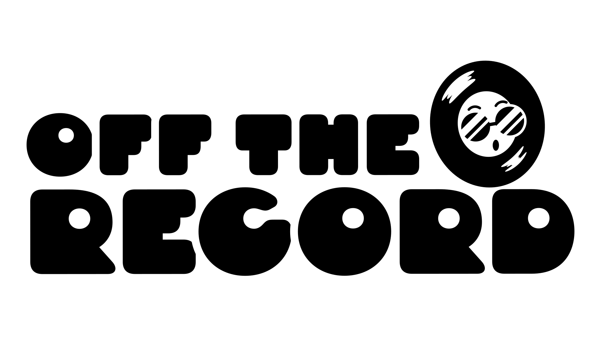
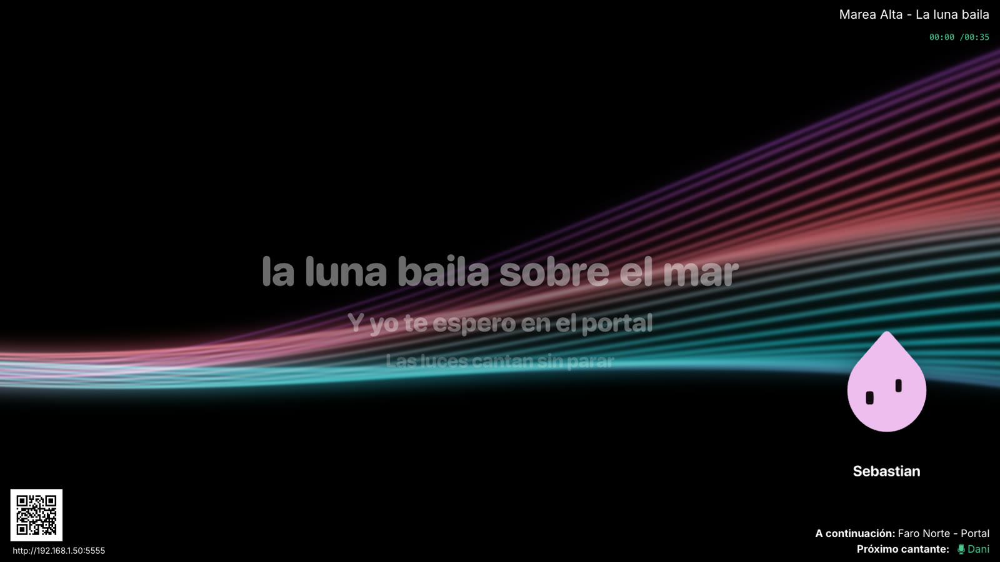
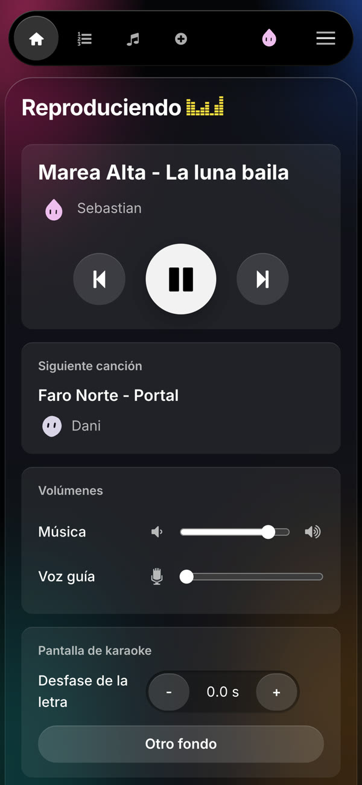
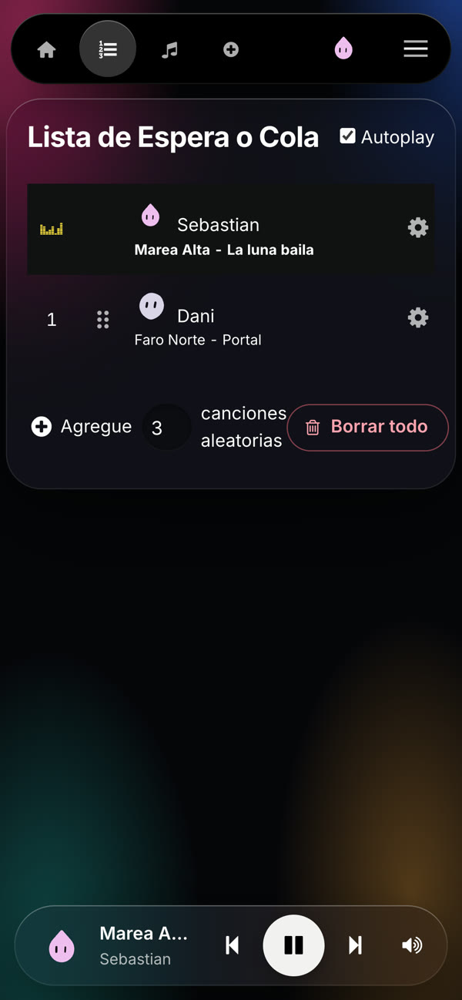
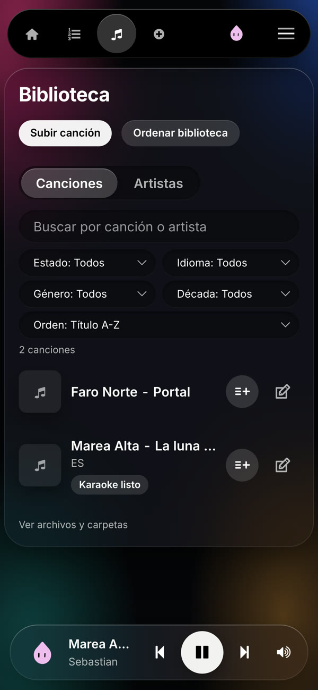
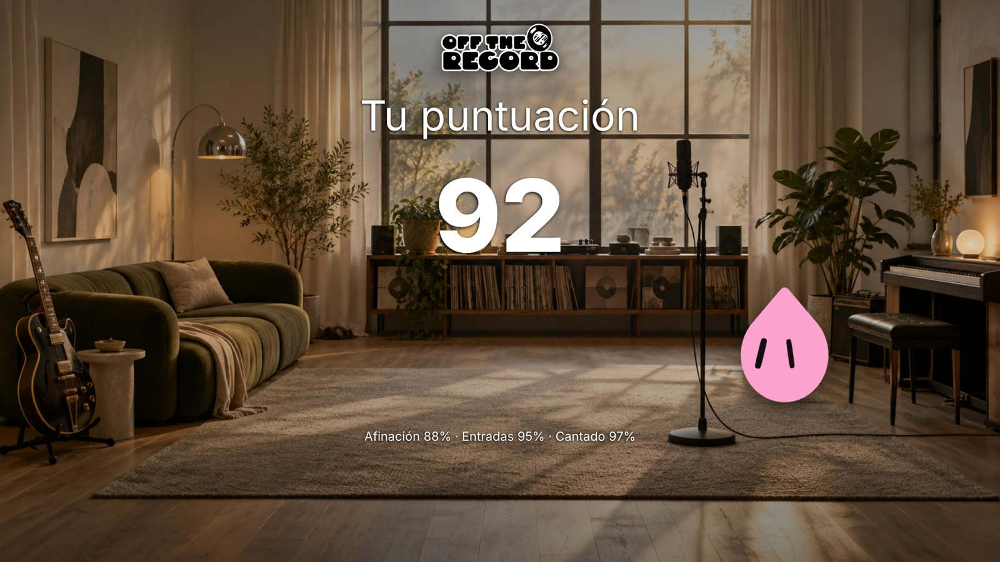
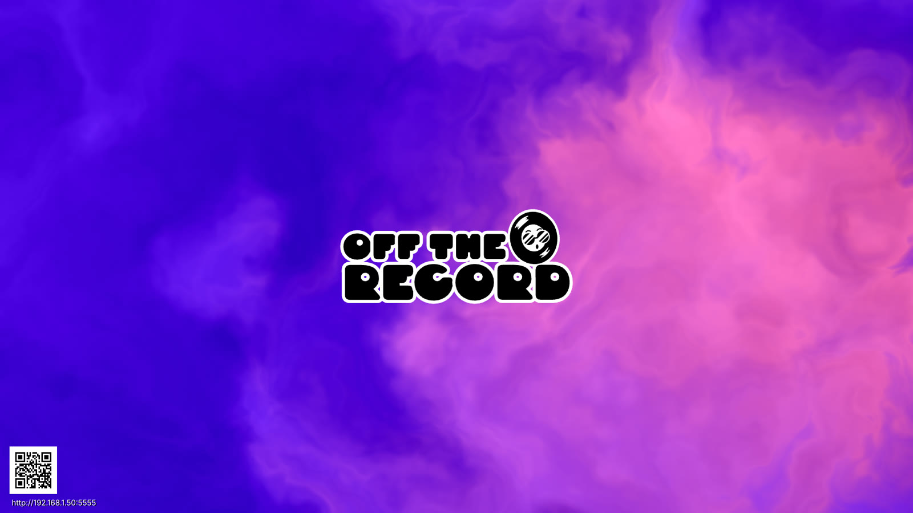

<p align="center">
  
</p>

<p align="center">
  <b>Karaoke en casa que le quita la voz a cualquier canción y muestra la letra palabra por palabra.</b><br>
  <sub>Home karaoke that removes the vocals from any song and shows word-timed lyrics, with an app for LG TVs. Started as a fork of <a href="https://github.com/vicwomg/pikaraoke">PiKaraoke</a>.</sub>
</p>

<p align="center">
  
</p>

## Qué hace

- **Se maneja desde el celular.** Los invitados escanean el QR de la tele, ponen su nombre y piden canciones. No hay que instalar ninguna app.
- **Busca la canción original.** En YouTube baja solo el audio, así que ocupa poco espacio.
- **Quita la voz con IA** ([Demucs](https://github.com/adefossez/demucs)). Deja una voz guía con su propio volumen, para quien la necesite.
- **Letra sincronizada.** Toma la letra de [LRCLIB](https://lrclib.net) y la alinea con la voz de la canción. Si no la encuentra, la transcribe ([faster-whisper](https://github.com/SYSTRAN/faster-whisper)).
- **Pantalla de la tele.**
  - Fondos animados con 20 paletas de colores.
  - El avatar de quien canta baila al ritmo y cambia de cara según cómo va cantando.
- **Puntaje real con micrófono.** Mide afinación, entradas a tiempo y cuánto se cantó. Sin micrófono no hay puntaje inventado.
- **Cambio de tono** en la música y en la voz guía.
- **Biblioteca ordenada.**
  - Cada artista aparece una sola vez, aunque esté escrito de distintas formas.
  - Carátulas, año y género.
  - Filtros por idioma, década y estado.
- **No descarga dos veces.** Si la canción ya está en la biblioteca (el mismo video, o el mismo artista y título), la pone en cola sin bajar ni procesar nada.
- **Si YouTube bloquea la conexión,** lo avisa en vez de insistir. En Ajustes se carga un `cookies.txt` de una cuenta de YouTube y las descargas siguen.
- **Modo admin con contraseña.** Los controles, los ajustes y borrar canciones quedan solo para el anfitrión.
- **Se abre desde cualquier dirección:** la red de la casa, [Tailscale](https://tailscale.com) o un nombre.

## App para tele LG


Para teles LG con webOS rooteadas (Homebrew Channel). Es la pantalla del karaoke en la tele,
sin navegador:

- **Control remoto:** reiniciar, pausa, siguiente y los volúmenes de la música, la voz guía y tu voz.
- **Micrófono USB** con la voz procesada en la tele: filtro de graves, compuerta, ecualizador de 5 bandas con estilos, compresor, de-esser, eco, reverb, anti-acople y limitador.
- **Poco retraso:** unos 70 ms del micrófono al oído por los parlantes de la tele. Con una tarjeta de sonido USB y un parlante aparte, la voz ni pasa por el procesador de la tele.
- **La voz guía va a tiempo con la música** (medido: menos de 15 ms de diferencia).
- **Guarda en la tele las próximas 5 canciones** de la cola y borra las que ya se cantaron, así no depende del Wi-Fi mientras se canta.
- **Puntaje** con la afinación que mide ese mismo micrófono.

## Capturas

<p align="center">
  
  
  
</p>

<p align="center">
  
  
</p>

<sub>Las capturas usan una canción inventada para las pruebas.</sub>

## Instalar

Necesitas una PC con Linux y Docker, con procesador x86-64 (Intel o AMD). La imagen es
`ghcr.io/sebastianov92/off-the-record`.

### CasaOS

1. App Store > botón **+** > **Install a customized app** > **Import**.
2. Pega el contenido de [`build_scripts/docker/off-the-record.casaos.yml`](build_scripts/docker/off-the-record.casaos.yml) e instala.

### Docker Compose

```bash
curl -O https://raw.githubusercontent.com/sebastianov92/off-the-record/karaoke-ai/build_scripts/docker/off-the-record.casaos.yml
docker compose -f off-the-record.casaos.yml up -d
```

Las canciones y los datos quedan en `/DATA/AppData/off-the-record/`. Para guardarlos en otro
lugar, cambia las rutas `source` del archivo.

### Tele LG (webOS)

Con la tele rooteada y Homebrew Channel, agrega el repositorio de LumiOS
(`https://github.com/sebastianov92/LumiOS/releases/latest/download/repo.json`) e instala
**Off the Record**. Al abrirla, escribe la dirección del servidor. Guía:
[docs/WEBOS.md](docs/WEBOS.md).

### Primer uso

- **Celular:** `http://<ip-de-la-pc>:5555`.
- **Tele:** la app de LG, o `http://<ip-de-la-pc>:5555/splash` en cualquier navegador.
- **Contraseña de admin:** ponla en el menú ☰ > Settings. Hasta entonces, todos son admin.
- **Primera canción:** tarda más, porque baja los modelos de IA (~1,6 GB). Después, cada canción tarda unos minutos y la música sigue sonando mientras tanto.

Guía detallada, compilación de la imagen y actualización: [docs/MINIPC.md](docs/MINIPC.md).
Cambios respecto de PiKaraoke: [docs/FORK.md](docs/FORK.md).

## Sin canciones incluidas

Off the Record no trae canciones, pistas ni letras. Cada quien es responsable de lo que descarga
o sube y de tener derecho a usarlo.

## Créditos y licencia

- Nació como fork de [PiKaraoke](https://github.com/vicwomg/pikaraoke), de Vic Wong. GPL-3.0, igual que PiKaraoke ([licencia](docs/LICENSE)).
- La app de la tele usa [tinyalsa](https://github.com/tinyalsa/tinyalsa) (BSD-3) y [jsmn](https://github.com/zserge/jsmn) (MIT).
- [Demucs](https://github.com/adefossez/demucs) (MIT) y [faster-whisper](https://github.com/SYSTRAN/faster-whisper) (MIT) para la IA.
- Letras de [LRCLIB](https://lrclib.net). Datos de [MusicBrainz](https://musicbrainz.org) y de iTunes Search.
- Avatares de [blobatar](https://blobatar.dev) (MIT). Tipografía [Inter](https://rsms.me/inter/) (SIL OFL 1.1).
- Marca Off the Record de Dezik Labs.
